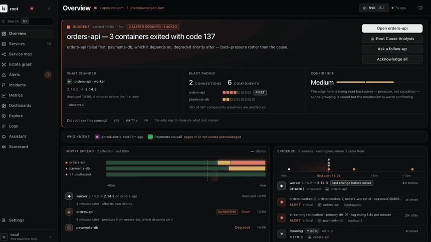
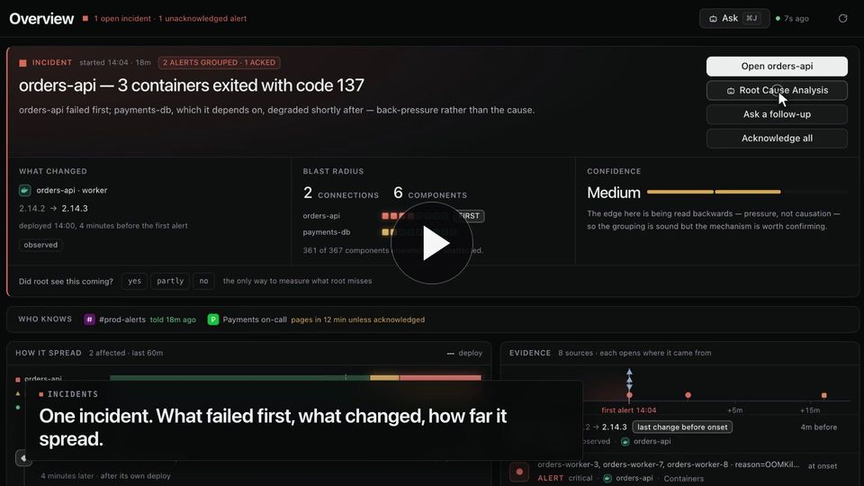
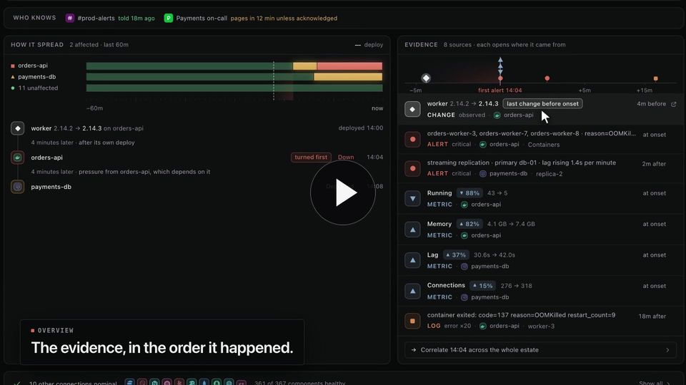
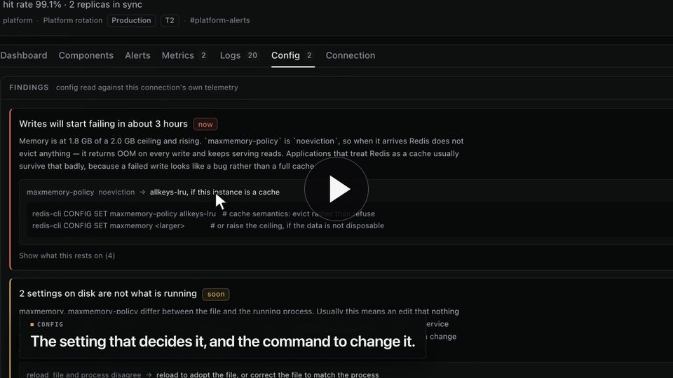
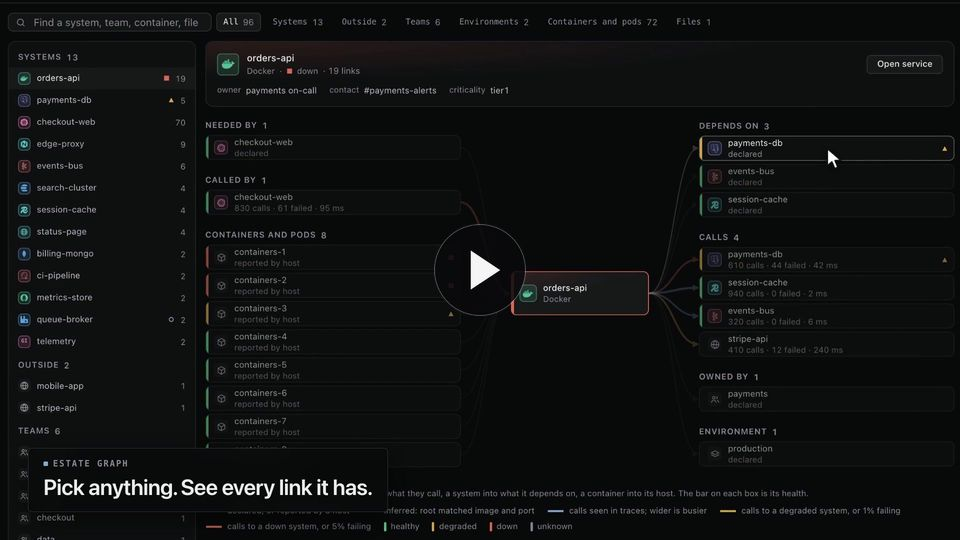
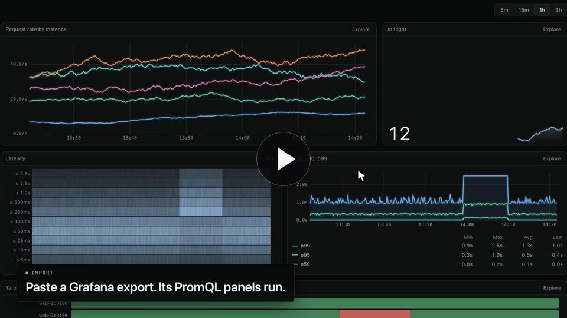
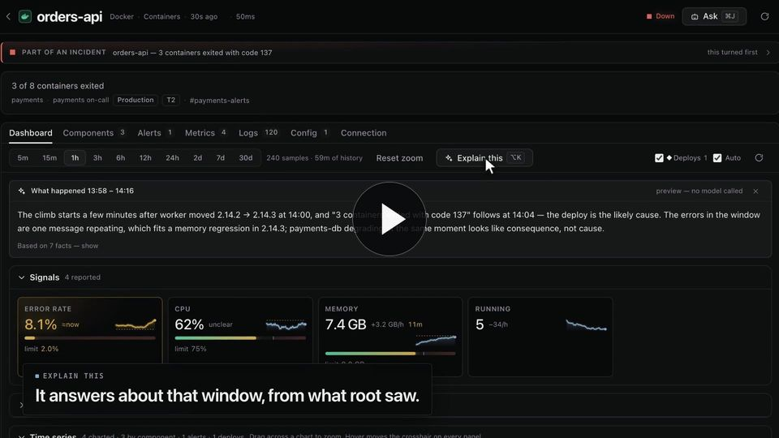
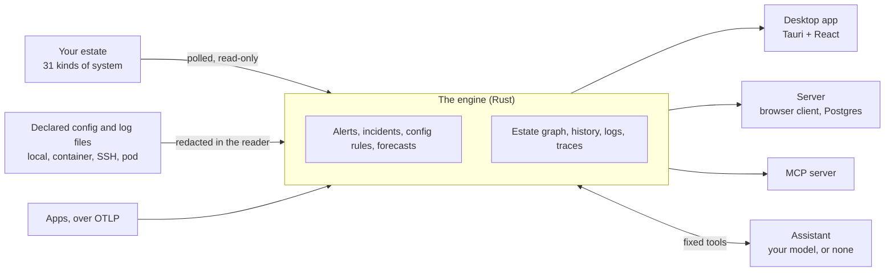

<p align="center">
  <picture>
    <source media="(prefers-color-scheme: dark)" srcset="website/media/logo-3d-dark.webp">
    
  </picture>
</p>

<h1 align="center">root</h1>

<p align="center"><b>Monitoring tells you something is wrong. root tells you why.</b></p>

<p align="center">
  Live health, metric history, one log stream, alerts and an assistant that can actually investigate,<br>
  across 31 kinds of infrastructure, from one window. Open source. Desktop or server.
</p>

<p align="center">
  <a href="https://aniketshukla1.github.io/root/"><b>Website</b></a> ·
  <a href="#what-it-does"><b>What it does</b></a> ·
  <a href="#the-films"><b>Films</b></a> ·
  <a href="#run-it"><b>Run it</b></a> ·
  <a href="#31-kinds-of-infrastructure"><b>31 kinds</b></a> ·
  <a href="#how-it-fits-together"><b>How it fits together</b></a> ·
  <a href="#status"><b>Status</b></a> ·
  <a href="docs/REFERENCE.md"><b>Reference</b></a>
</p>

<p align="center">
  <a href="https://github.com/aniketshukla1/root/actions/workflows/ci.yml"></a>
  <a href="https://aniketshukla1.github.io/root/"></a>
  <a href="#status"></a>
  <a href="LICENSE"></a>
  <a href="https://github.com/aniketshukla1/root/commits/main"></a>
</p>

<p align="center">
  <a href="#31-kinds-of-infrastructure"></a>
  <a href="docs/REFERENCE.md#tests"></a>
  <a href="#run-it"></a>
  <a href="#run-it"></a>
  <a href="docs/REFERENCE.md#the-assistant"></a>
  <a href="docs/REFERENCE.md#root-as-an-mcp-server"></a>
</p>

<p align="center">
  <a href="#how-it-fits-together"></a>
  <a href="#how-it-fits-together"></a>
  <a href="#how-it-fits-together"></a>
  <a href="#how-it-fits-together"></a>
  <a href="#how-it-fits-together"></a>
  <a href="#how-it-fits-together"></a>
  <a href="#how-it-fits-together"></a>
</p>

<p align="center">
  <a href="https://aniketshukla1.github.io/root/"></a>
</p>

<table>
  <tr>
    <td align="center" valign="top" width="25%"><h3>31</h3>kinds of infrastructure, polled read-only</td>
    <td align="center" valign="top" width="25%"><h3>4</h3>places it reads config and logs: this machine, a container, SSH, a pod</td>
    <td align="center" valign="top" width="25%"><h3>830+</h3>tests in CI on Linux and macOS, with a real TimescaleDB on Linux</td>
    <td align="center" valign="top" width="25%"><h3>0</h3>models required. Add Anthropic, any OpenAI-compatible endpoint or Ollama if you want the assistant</td>
  </tr>
  <tr>
    <td align="center" valign="top" width="25%"><h3>2</h3>ways to run one engine: the desktop app, or a server with a browser client</td>
    <td align="center" valign="top" width="25%"><h3>2</h3>containers to deploy it: root-server and Postgres. No broker, no cache, no sidecar</td>
    <td align="center" valign="top" width="25%"><h3>7</h3>days of history an alert rule replays against before you save it</td>
    <td align="center" valign="top" width="25%"><h3>0</h3>actions the assistant takes without your approval</td>
  </tr>
</table>

---

## Monitoring is half of it

Watching tells you a thing is wrong. Reading the configuration that governs it tells you why, and which number to change.

A Redis at 1.8 GB of a 2 GB `maxmemory` with `maxmemory-policy noeviction` is not a memory graph to keep an eye on. It is a decision that starts refusing writes in about three hours, and neither the metric nor the config file says so alone. root reads both, and says:

> **Writes will start failing in about 3 hours.** Memory is at 1.8 GB of a 2.0 GB ceiling and rising. `maxmemory-policy` is `noeviction`, so when it arrives Redis does not evict anything: it returns OOM on every write and keeps serving reads.
>
> ```
> redis-cli CONFIG SET maxmemory-policy allkeys-lru   # cache semantics: evict rather than refuse
> ```

## What it does

<table>
  <tr><td width="30%"><b>One incident, not a list of alerts</b></td><td>Alerts group by onset time, declared dependencies and observed changes, with no model involved. You see what failed first, what changed and how far it spread.</td></tr>
  <tr><td width="30%"><b>It reads your config</b></td><td>You declare the paths: on this machine, inside a Docker container, over SSH or inside a Kubernetes pod. Secrets are redacted in the reader, and findings come from rules that always fire on the same input.</td></tr>
  <tr><td width="30%"><b>An estate graph</b></td><td>Every connection, container, outside service, team and file as one graph you can walk. Every link says how root knows it: declared, reported, observed or inferred.</td></tr>
  <tr><td width="30%"><b>Grafana dashboards, imported</b></td><td>Paste an export and its PromQL panels run. Explore PromQL, LogQL and traces. Alert rules replay the last week before you save them.</td></tr>
  <tr><td width="30%"><b>An assistant with real access and deliberate limits</b></td><td>Read-only by default. With actions allowed, every call stops for approval. No shell tool and no arbitrary SQL. Bring Anthropic, any OpenAI-compatible endpoint, or Ollama, where nothing leaves the machine.</td></tr>
  <tr><td width="30%"><b>It keeps score</b></td><td>A Scorecard of which findings were right, which were noise and which problems it missed.</td></tr>
</table>

## The films

Each one is the real app, filmed with its built-in demo data. Click through to watch with sound.

<table>
  <tr>
    <td width="50%"><a href="https://aniketshukla1.github.io/root/#top"></a><br><b>The launch film</b> · 0:25<br>The whole idea, from the splash to the end card.</td>
    <td width="50%"><a href="https://aniketshukla1.github.io/root/#incident"></a><br><b>From first alert to root cause</b> · 0:34<br>Alerts, how it spread, the analysis, the assistant, the record.</td>
  </tr>
  <tr>
    <td><a href="https://aniketshukla1.github.io/root/#config"></a><br><b>Monitoring is half of it</b> · 0:32<br>A finding, the fix, the evidence, redaction, where files live.</td>
    <td><a href="https://aniketshukla1.github.io/root/#graph"></a><br><b>What is this connected to?</b> · 0:24<br>The service map and the estate graph.</td>
  </tr>
  <tr>
    <td><a href="https://aniketshukla1.github.io/root/#dashboards"></a><br><b>Bring your Grafana dashboards</b> · 0:28<br>Import, Explore, a trace waterfall, a rule replayed.</td>
    <td><a href="https://aniketshukla1.github.io/root/#assistant"></a><br><b>Select it. Ask about it.</b> · 0:18<br>The answer sits on the chart window or log lines you asked about.</td>
  </tr>
</table>

## Run it

**Look at the interface in a browser, with demo data and no Rust.** It needs Node 22.

```bash
git clone https://github.com/aniketshukla1/root
cd root
npm install
npm run dev
# then open http://localhost:1420/?estate=incident
```

**The desktop app.** Nothing to configure and nobody to sign in to. It reads a config file you own, holds credentials in the OS keychain and binds loopback only. It needs Node 22, a Rust toolchain and the [Tauri 2 prerequisites](https://tauri.app/start/prerequisites/), plus CMake for the bundled Kafka client and, on Linux, curl's headers (`libcurl4-openssl-dev`).

```bash
npm install
npm run tauri dev
```

Nothing to connect yet? Start the **live demo** from the first-run screen: a simulated shop of thirteen connections, where every twelve minutes something goes wrong.

**The server.** Collectors run somewhere that stays up, history goes to Postgres, and the client is a browser on any device, with accounts, roles and single sign-on. It refuses to start without a token. See [`deploy/README.md`](deploy/README.md).

```bash
cd deploy
cp .env.example .env   # put real values in it
docker compose up -d
open http://localhost:7777
```

## 31 kinds of infrastructure

<table>
  <tr><td width="30%"><b>Containers and orchestration</b></td><td>Docker, Podman, Kubernetes</td></tr>
  <tr><td width="30%"><b>Hosts and storage</b></td><td>This computer, Linux host, SSH server, NFS exports</td></tr>
  <tr><td width="30%"><b>Web and endpoints</b></td><td>HTTP endpoint, Nginx, Apache httpd, Apache Tomcat, HAProxy, Traefik</td></tr>
  <tr><td width="30%"><b>Databases</b></td><td>PostgreSQL, MySQL, MongoDB, ClickHouse</td></tr>
  <tr><td width="30%"><b>Caching and search</b></td><td>Redis, Memcached, Elasticsearch</td></tr>
  <tr><td width="30%"><b>Messaging and coordination</b></td><td>Kafka, RabbitMQ, NATS, ZooKeeper, Consul, etcd</td></tr>
  <tr><td width="30%"><b>CI, observability and cloud</b></td><td>Jenkins, Prometheus, Gigapipe, OpenTelemetry, AWS</td></tr>
</table>

Adding a kind is a backend-only change: the frontend knows about no service type in particular. [How to add one](docs/REFERENCE.md#adding-a-service-type).

## How it fits together



The desktop app and the server run the same engine. Everything works with no model configured; the assistant adds to it.

## Status

Version 0.1, built from source: there are no signed installers yet. Every push to `main` runs Clippy with warnings as errors, the backend suites on Linux and macOS, on Linux against a real TimescaleDB ([list](docs/REFERENCE.md#tests)), the frontend checks and bundle budget, and a build of the server image. Suites for services CI does not run, such as Redis, Kafka and Kubernetes, skip there and run when one is up. Reading files inside a container, inside a pod and from a journal over SSH have tests but have not yet been exercised against a live engine or cluster, so reports are welcome.

## More

- [The reference](docs/REFERENCE.md): every collector, the assistant's limits, the MCP server, credentials, the layout
- [Frontend architecture](FRONTEND_ARCHITECTURE.md), [Gigapipe](GIGAPIPE.md), [Releasing](RELEASING.md)
- [Contributing](CONTRIBUTING.md) and [Security](SECURITY.md)

## License

[MIT](LICENSE)
